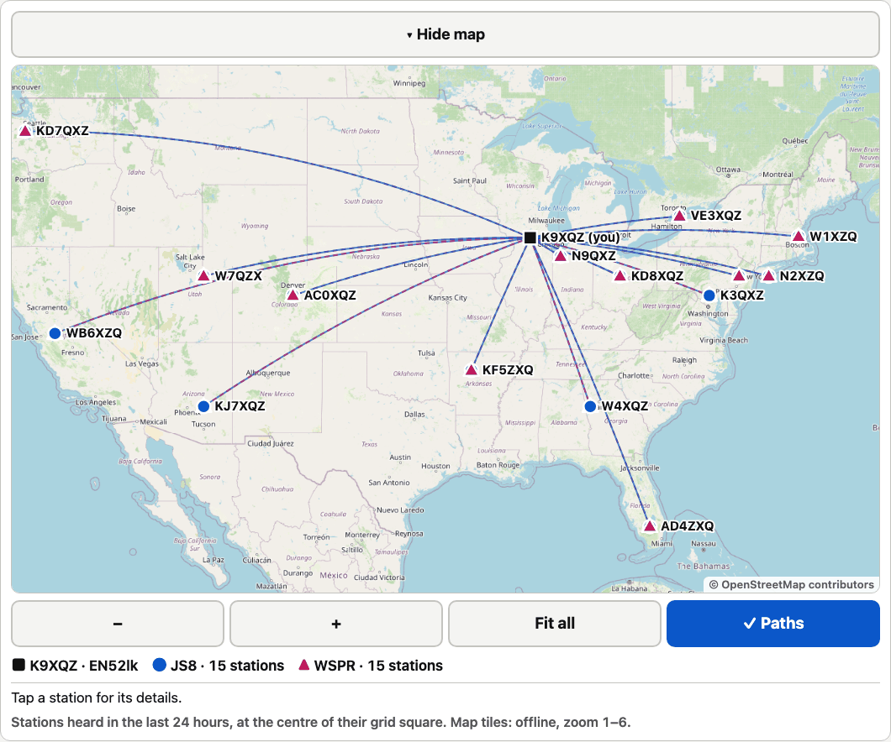
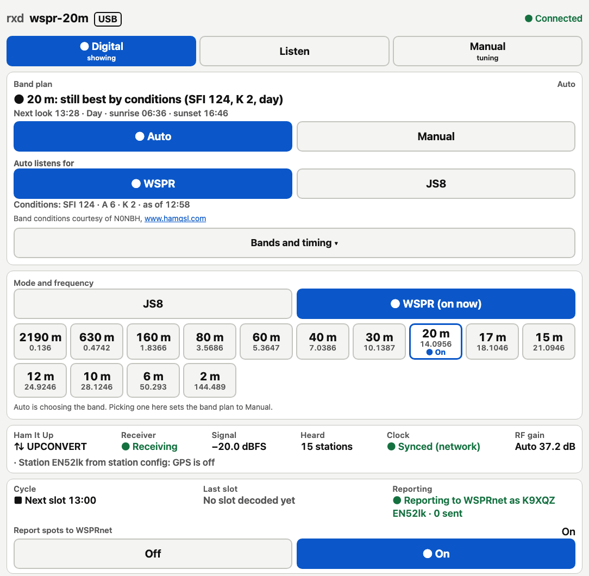
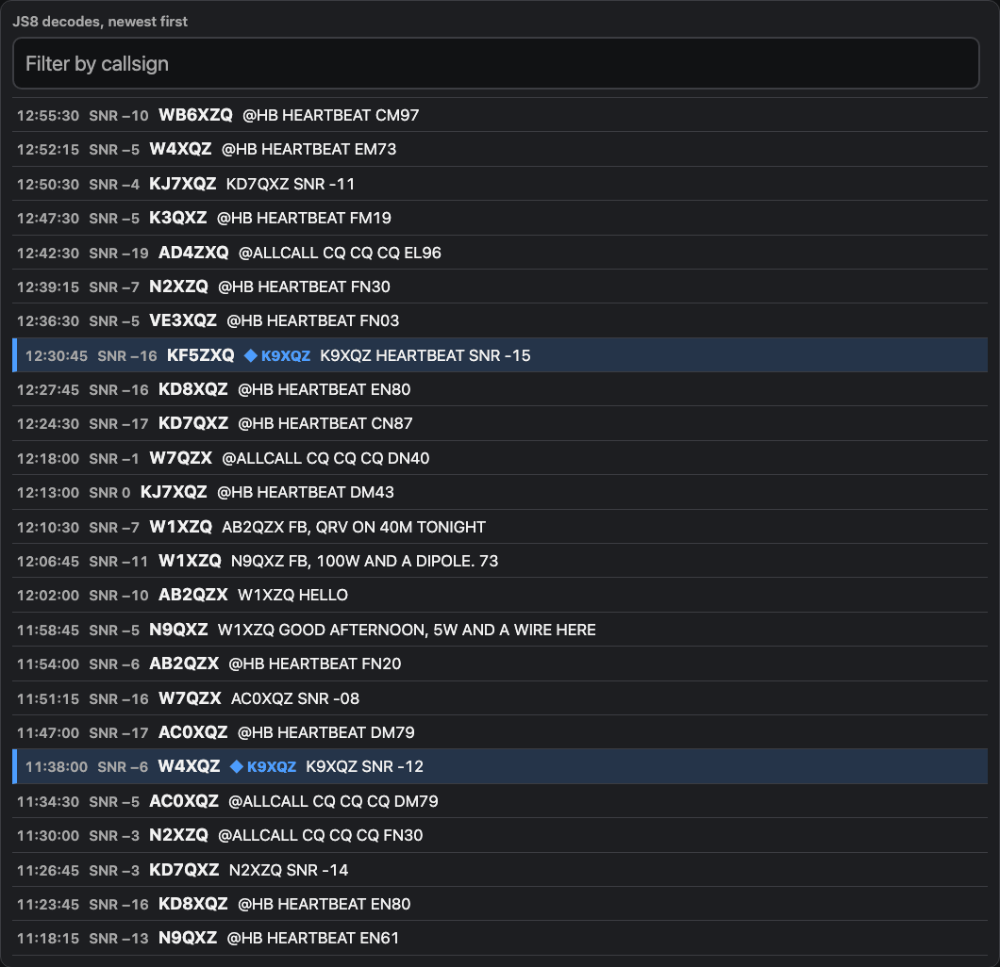
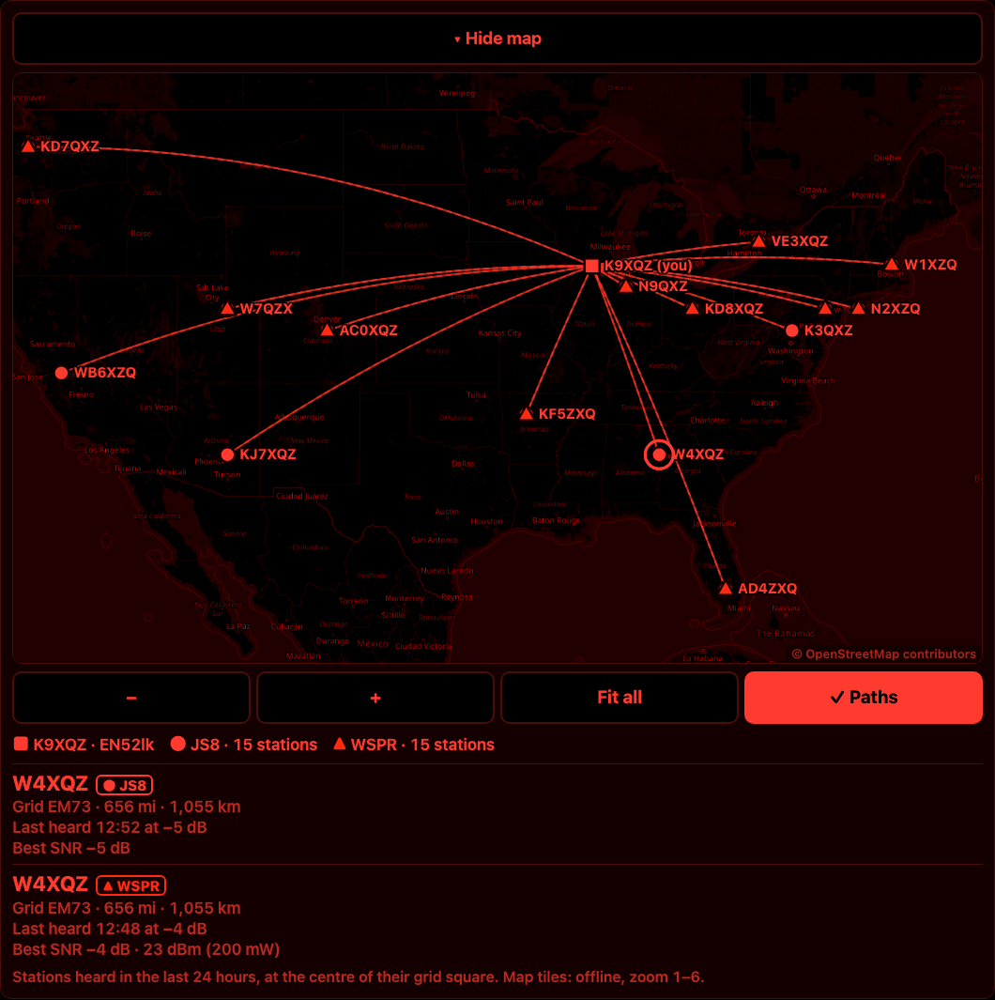
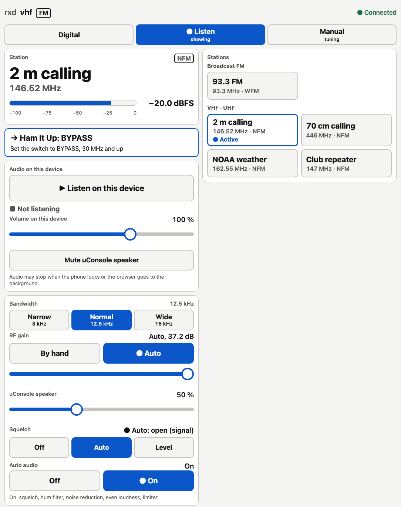

<p align="center"></p>

<p align="center">
  <a href="LICENSE"></a>
  <a href="https://github.com/pid1/rxd/actions/workflows/test.yml"></a>
  <a href="docs/reference.md#measured-on-the-uconsole-cm4-2026-11-05"></a>
  <a href="#design-principles"></a>
</p>

<p align="center">
  <a href="docs/install.md">Install</a> •
  <a href="docs/station.md">Station file</a> •
  <a href="docs/API.md">HTTP API</a> •
  <a href="docs/reference.md">Reference</a>
</p>

<p align="center"><em>One RTL-SDR, a small computer, and JS8 and WSPR decoded all day.</em></p>

## What is rxd?

rxd is a small receiver daemon for an RTL-SDR, written in Python. It tunes one channel, plays it to a speaker, and decodes JS8 and WSPR from it. It reports WSPR spots to WSPRnet, picks the band itself, and maps the stations it hears on offline tiles.

It is receive only. Nothing in it transmits. It runs on a Raspberry Pi CM4 (it was written on a ClockworkPi uConsole), needs only Python 3.11 with numpy and scipy, and is controlled over a documented HTTP API.

## An afternoon with rxd

1. You start rxd on WSPR and put the band plan on Auto. It reads N0NBH's band conditions and the sun at your grid, and picks 20 m.
2. Every two minutes rxd records a slot and runs `wsprd` on it. The spots go to WSPRnet under your call and grid.
3. You set Auto to listen for JS8 instead. rxd decodes it itself. Heartbeats and CQs carry a grid, so those stations land on the map, beside the WSPR spots.
4. Every half hour, by default, it looks again. When another band scores clearly better, rxd switches to it.
5. You open the web UI on your phone and press **Listen on this device**.

## What it does

- **Receives one channel** from one RTL-SDR: USB, LSB, AM, FM or WFM (in mono), to a PipeWire or PulseAudio sink.
- **Plays HD Radio** on FM broadcast stations when [nrsc5](https://github.com/theori-io/nrsc5) is installed: analog first, then HD1 once the digital signal is clean, lined up so the switch is seamless, and back to analog when it fades. HD2 and HD3 too, with the station's name and what's playing.
- **Decodes JS8 itself**, with its own decoder, in all four speeds: normal, fast, turbo and slow (turbo is off by default). No JS8Call code is used.
- **Decodes WSPR** with `wsprd` and reports the spots to WSPRnet as your call at your grid. Spots that can't be sent wait for the next slot.
- **Picks the band itself** on Auto: from the band conditions, the sun at your grid and what it has heard at this hour. Without internet it scans the bands and keeps the counts.
- **Maps the stations it hears** on offline tiles, with great-circle paths. A station sits at the centre of the grid it sent, or where the offline callsign database places it.
- **Sets its own RF gain** from the raw IQ, and cleans up the audio for listening: squelch, hum filter, noise reduction, even loudness and a limiter. The decoders always get the audio untouched.
- **Plays to your phone.** The web UI streams the audio to the browser, and `rxd-tui` plays it on the machine it runs on.
- **Switches with one command.** `radio NAME` brings a profile up ready to listen, and each one resumes where you left it.
- **Takes its grid from a GPS** through gpsd, once the fix is steady, and keeps only the 6-character grid.
- **Says when the clock is off.** JS8 and WSPR fail silently past about 2 s of error, so rxd shows what chrony says.

| | |
|---|---|
|  |  |
|  |  |

The screenshots are of a demo station with made-up data: K9XQZ, the stations it hears and their messages are fictional.

## Install

You need Linux with systemd and PipeWire (or PulseAudio), Python 3.11 or later with numpy and scipy, librtlsdr and libpulse-simple, and `wsprd` (Debian's `wsjtx`) for WSPR. On Raspberry Pi OS or Debian:

```bash
sudo apt install python3-numpy python3-scipy librtlsdr0 libpulse0 wsjtx chrony
```

For HD Radio, build nrsc5 too ([docs/install.md](docs/install.md#hd-radio-nrsc5)). Without it FM is analog only.

Then install a release, verified by its checksum:

```bash
v=0.5.0
curl -fLO https://github.com/pid1/rxd/releases/download/v$v/rxd-$v.tar.gz
curl -fLO https://github.com/pid1/rxd/releases/download/v$v/rxd-$v.tar.gz.sha256
sha256sum -c rxd-$v.tar.gz.sha256 && tar xzf rxd-$v.tar.gz
sudo python3 rxd-$v/install.py --prefix /usr/local --user "$USER"
```

The installer puts the code in `/usr/local/lib/rxd/`, links `rxd`, `radio` and `rxd-tui` into `/usr/local/bin`, and installs the `rxd@.service` user unit. As you, it fetches JS8's word table (checked against a pinned SHA-256) and the callsign database. It's safe to run again, and offline is fine: rxd works without either file.

Then write the [station file](docs/station.md), `/etc/rxd/station.json`, with at least your `call`, `grid` and the dongle's `sdr.serial`, and run `radio js8`. Open `http://localhost:8073/`, or run `rxd-tui`.

[docs/install.md](docs/install.md) has the details: what goes where, every option, serving your network, and running from a checkout.

### Agent instructions

Paste this into an AI agent that can run a shell on the Raspberry Pi, to install rxd for you:

```text
Install rxd (https://github.com/pid1/rxd) on this Raspberry Pi. Ask me before any step that needs my password (sudo included) or a sign-in, and let me type it myself. Never write a password to a file.

1. Read README.md, docs/install.md and docs/station.md in full.
2. Check that Python is 3.11 or later. Install python3-numpy, python3-scipy, librtlsdr0, libpulse0, wsjtx, chrony and rtl-sdr with apt.
3. Download rxd-0.4.0.tar.gz and rxd-0.4.0.tar.gz.sha256 from the v0.4.0 release. Run sha256sum -c on the .sha256 file. If it fails, stop and tell me.
4. Unpack it and run: sudo python3 rxd-0.4.0/install.py --prefix /usr/local --user "$USER"
5. Run rtl_test to find the RTL-SDR's serial number. Ask me for my callsign and Maidenhead grid, and whether there is an upconverter in front of the dongle. Don't guess any of them.
6. Write /etc/rxd/station.json as docs/station.md describes, with call, grid and sdr.serial, and the upconverter if I have one. Show it to me before you write it.
7. Leave the API on 127.0.0.1:8073. Only if I ask, set RXD_HTTP=0.0.0.0:8073 in /etc/rxd/rxd.env, and tell me it has no authentication, so it belongs behind a firewall.
8. As me, run: radio js8
9. Confirm with: curl -s http://127.0.0.1:8073/api/v1/status. It should show "running": true and "api_version": 1. Report the profile, the station's call and grid, and any entries in station.problems.
```

## Clients

rxd comes with two **reference clients**. Neither is the only way in.

- **The web UI** (`clients/web/index.html`), served by rxd at `http://HOST:8073/`. One self-contained page with no external requests, in Day, Dark and Night (red) themes, sized for a phone up to a desktop.
- **`rxd-tui`** (`clients/tui/rxd_tui.py`), for a terminal, with the same three views. It can play the audio on its own machine.

Everything they do goes through the documented **[HTTP API](docs/API.md)**, version 1, under `/api/v1/`: status, tuning, the spectrum, profiles, JS8 decodes, WSPR spots, the station map, the band plan and the audio stream. Use either client, use any other, or build your own against the API. Both check the API version rxd reports, and say plainly when they reach an rxd they don't understand.

## Design principles

- **Receive only.** Nothing in rxd transmits.
- **Decode it yourself.** rxd decodes JS8 with its own decoder, written from the protocol, and WSPR with WSJT-X's `wsprd`. Against JS8Call on the same 17 minutes of 40 m audio, it decoded 92 % of the messages JS8Call did. See [the reference](docs/reference.md#checked-against-js8call-2026-11-06-40-m-7078-mhz).
- **Works offline.** The map tiles and the callsign database are on disk, and nothing is looked up online while rxd runs. Without internet the band plan scans the bands instead, and unsent WSPR spots wait. The uConsole's provisioning, [pid1/rx](https://github.com/pid1/rx), keeps the release for offline reinstalls.
- **Light on a CM4.** Live on 40 m, decoding three JS8 speeds with an earlier build, rxd used 17 % of one core and its JS8 decoder 25 %. JS8Call's decoder used 63 % on the same audio, and SDR++Brown alone about 220 %. Measured on a uConsole's CM4: [JS8](docs/reference.md#cpu-on-the-uconsole), [the DSP](docs/reference.md#measured-on-the-uconsole-cm4-2026-11-05).
- **An API first.** The web UI and `rxd-tui` are reference clients of a versioned, documented HTTP API. A change that would break a client goes to a new version.
- **Private by default.** rxd keeps only a 6-character grid from the GPS, never the precise position. The API listens on 127.0.0.1 unless you choose otherwise.
- **Nothing machine-specific in the code.** Your callsign, hardware and local stations go in one [station file](docs/station.md).

## License

BSD 3-Clause. Made by Jonathan Roemer. See [LICENSE](LICENSE). The JSC word table the installer fetches is JS8Call's (GPL-3) and is never in this repository.
